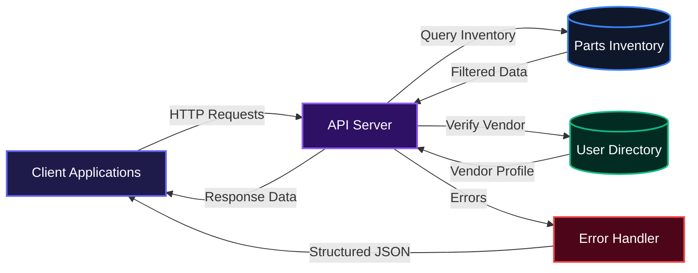
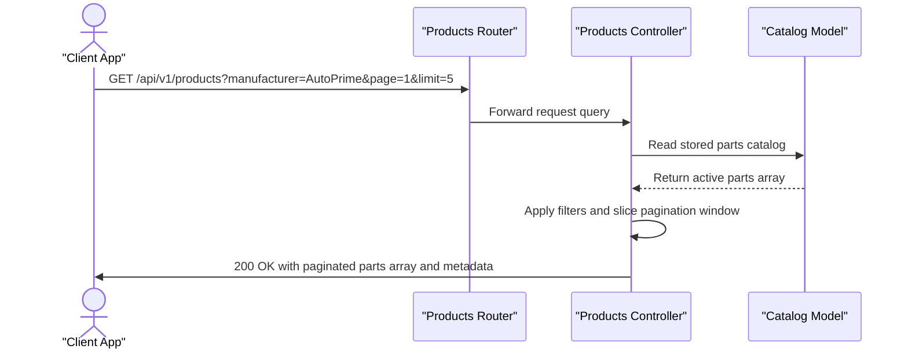
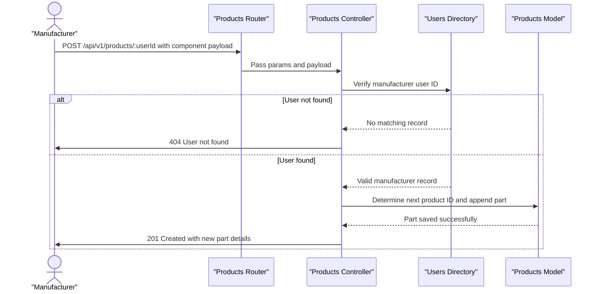

# E-Commerce Car Part Store API

E-Commerce Car Part Store API gives automotive retailers and marketplace developers a direct way to manage, query, and distribute vehicle replacement parts inventory. It solves catalog search friction by providing structured pagination, manufacturer-based indexing, and verified vendor part additions out of the box. Teams can quickly power web and mobile auto shops with dependable inventory data and uniform error responses.

## System Architecture



## Features

### Dynamic Inventory Slicing and Query Filtering
Clients can request targeted subsets of spare parts across dimensions, manufacturer labels, and pagination boundaries. The controller filters the inventory on the fly, computes pagination metadata, and segments results according to page and limit parameters.



### Verified Manufacturer Part Publishing
Registered manufacturers can publish new catalog components with auto-incrementing identifiers. The API validates the vendor identifier against the directory of authorized manufacturers before appending new specifications, vehicle compatibilities, and pricing.



### Role-Segmented User Directory
Consuming applications can inspect buyers and verified manufacturers using role filters. The directory controller delivers paginated user profiles, facilitating account management, vendor onboarding checks, and buyer segmentation.

### Centralized Exception Diagnostics
Any unexpected runtime error or manually thrown validation failure passes through a dedicated error handler. In development environments, the handler includes detailed stack traces, HTTP method context, query parameters, and timestamps to speed up debugging.

## Technologies Used

| Technology | Purpose | Documentation |
| :--- | :--- | :--- |
| Node.js | JavaScript runtime environment | [nodejs.org](https://nodejs.org/) |
| Express | Web application and routing framework | [expressjs.com](https://expressjs.com/) |
| Dotenv | Environment configuration loader | [github.com/motdotla/dotenv](https://github.com/motdotla/dotenv) |

## Environment Variables

The server uses the following environment variables to configure execution parameters:

| Variable | Description | Default Value | Example |
| :--- | :--- | :--- | :--- |
| `PORT` | Network port for listening on incoming requests | `5000` | `3000` |
| `NODE_ENV` | Application environment mode (`development` or `production`) | None | `development` |

### Setting Environment Variables at the System Level

To configure environment variables at the operating system level, run the following commands in your terminal:

Windows (PowerShell):
```powershell
setx PORT "3000"
```

macOS / Linux (including Termux on Android):
```bash
echo 'export PORT="3000"' >> ~/.bashrc
source ~/.bashrc
```

## Installation

Follow these steps to set up the project on your local machine:

1. Clone the repository:
```bash
git clone https://github.com/Aisdev979/e-commerce_store_api.git
```

2. Navigate into the project folder:
```bash
cd e-commerce_store_api
```

3. Install project dependencies:
```bash
npm install
```

4. Create a `.env` configuration file in the project root:
```bash
touch .env
```

5. Add your configuration values to `.env`:
```text
PORT=3000
NODE_ENV=development
```

## Usage

Start the server using Node:
```bash
node server.js
```

Verify that the service is running:
```bash
curl http://localhost:3000/
```

Expected terminal output:
```text
Welcome to the E-commerce Car Part Store API!
```

Query the automotive inventory with filters:
```bash
curl "http://localhost:3000/api/v1/products?manufacturer=AutoPrime&page=1&limit=2"
```

Create a new product as a verified manufacturer:
```bash
curl -X POST http://localhost:3000/api/v1/products/usr_101 \
  -H "Content-Type: application/json" \
  -d '{
    "name": "High Performance Fuel Injector",
    "brand": "AutoPrime",
    "category": "Fuel System",
    "price": 89.99,
    "stock_quantity": 40
  }'
```

Fetch registered vendors in the system:
```bash
curl "http://localhost:3000/api/v1/users?role=manufacturer&page=1&limit=3"
```

## API Documentation

#### GET /

**Description**: Root health check endpoint that confirms the service is online.

**Request**:
```text
GET / HTTP/1.1
Host: localhost:3000
```

**Response**:
```text
Welcome to the E-commerce Car Part Store API!
```

**Errors**:
- 500: Internal Server Error

---

#### GET /api/v1/products

**Description**: Retrieves a paginated list of catalog parts, optionally filtered by manufacturer and part size label.

**Query Parameters**:
- `manufacturer` (optional): Filter parts by manufacturer name (e.g. `AutoPrime Components Ltd`).
- `size` (optional): Filter parts by the exact size label string.
- `page` (optional, default: `1`): Current page index to fetch.
- `limit` (optional, default: `5`): Maximum items returned per page.

**Request**:
```text
GET /api/v1/products?manufacturer=AutoPrime%20Components%20Ltd&page=1&limit=1 HTTP/1.1
Host: localhost:3000
```

**Response**:
```json
{
  "success": true,
  "meta": {
    "totalRecord": 1,
    "curentPage": 1,
    "totalPags": 1
  },
  "data": [
    {
      "id": "prd_001",
      "user_id": "usr_101",
      "manufacturer": "AutoPrime Components Ltd",
      "sku": "AP-SPK-IR4",
      "part_number": "AP-IR14-4",
      "name": "Iridium Spark Plug Set (4 pcs)",
      "brand": "AutoPrime",
      "category": "Engine",
      "sub_category": "Ignition",
      "description": "Fine-wire iridium spark plugs for stable idle and long service life.",
      "condition": "new",
      "size": {
        "label": "M14 x 1.25 thread, 19 mm reach, 16 mm hex",
        "unit": "mm",
        "length_mm": 65,
        "width_mm": 16,
        "height_mm": 16,
        "diameter_mm": 14,
        "thickness_mm": null,
        "size_code": "M14x1.25"
      },
      "weight_kg": 0.2,
      "material": "Iridium / nickel alloy",
      "position": "N/A",
      "specs": {
        "thread": "M14x1.25",
        "reach_mm": 19,
        "hex_mm": 16,
        "gap_mm": 1.1,
        "pack_qty": 4
      },
      "compatibility": [
        {
          "make": "Toyota",
          "model": "Camry",
          "year_from": 2007,
          "year_to": 2011,
          "engine": "2.4L",
          "trim": "All"
        }
      ],
      "price": 34.99,
      "currency": "USD",
      "stock_quantity": 240,
      "warranty_months": 12,
      "country_of_origin": "DE",
      "status": "active",
      "created_at": "2026-03-10T09:00:00Z"
    }
  ]
}
```

**Errors**:
- 500: Internal Server Error

---

#### GET /api/v1/products/:productId

**Description**: Retrieves details for a specific car part using its ID.

**Path Parameters**:
- `productId` (required): Identifier of the product to fetch.

**Request**:
```text
GET /api/v1/products/1 HTTP/1.1
Host: localhost:3000
```

**Response**:
```json
{
  "success": true,
  "meta": {
    "length": 1
  },
  "data": {
    "id": 1,
    "name": "Ceramic Brake Pads",
    "price": 45.99
  }
}
```

**Errors**:
- 400: Bad Request if the product ID parameter is empty.
```json
{
  "status": "error",
  "message": "Please provide and ID, can't be empty",
  "statusCode": 400
}
```
- 404: Not Found if the part does not exist in inventory.
```json
{
  "status": "error",
  "message": "Parts not found",
  "statusCode": 404
}
```
- 500: Internal Server Error

---

#### POST /api/v1/products/:userId

**Description**: Registers a new product component under an existing manufacturer account.

**Path Parameters**:
- `userId` (required): The unique account ID of the manufacturer (e.g. `usr_101`).

**Request**:
```json
{
  "name": "High-Flow Synthetic Oil Filter",
  "manufacturer": "AutoPrime Components Ltd",
  "brand": "AutoPrime",
  "category": "Filters",
  "sub_category": "Oil Filter",
  "price": 14.99,
  "stock_quantity": 120,
  "condition": "new",
  "warranty_months": 12
}
```

**Response**:
```json
{
  "success": true,
  "message": "Product added successfully",
  "newProductData": {
    "id": "prd_21",
    "user_id": "usr_101",
    "name": "High-Flow Synthetic Oil Filter",
    "manufacturer": "AutoPrime Components Ltd",
    "brand": "AutoPrime",
    "category": "Filters",
    "sub_category": "Oil Filter",
    "price": 14.99,
    "stock_quantity": 120,
    "condition": "new",
    "warranty_months": 12
  }
}
```

**Errors**:
- 400: Bad Request if the manufacturer ID parameter is missing.
```json
{
  "status": "error",
  "message": "provided and ID to proceed",
  "statusCode": 400
}
```
- 404: Not Found if the provided manufacturer user ID is not registered.
```json
{
  "status": "error",
  "message": "User not found",
  "statusCode": 404
}
```
- 500: Internal Server Error

---

#### GET /api/v1/users

**Description**: Retrieves a paginated list of accounts, optionally filtered by user role (`buyer` or `manufacturer`).

**Query Parameters**:
- `role` (optional): Filter users by role designation (e.g. `buyer`, `manufacturer`).
- `page` (optional, default: `1`): Current page index to fetch.
- `limit` (optional, default: `5`): Maximum users to return per page.

**Request**:
```text
GET /api/v1/users?role=manufacturer&page=1&limit=2 HTTP/1.1
Host: localhost:3000
```

**Response**:
```json
{
  "success": true,
  "meta": {
    "totalRecord": 6,
    "curentPage": 1,
    "totalPags": 3
  },
  "data": [
    {
      "id": "usr_101",
      "role": "manufacturer",
      "name": "Klaus Brenner",
      "company_name": "AutoPrime Components Ltd",
      "email": "klaus.brenner@autoprime.example.com",
      "phone": "+49 711 555 0201",
      "country": "DE",
      "city": "Stuttgart",
      "is_verified": true,
      "status": "active",
      "created_at": "2025-11-03T09:00:00Z"
    },
    {
      "id": "usr_102",
      "role": "manufacturer",
      "name": "Hiroshi Tanaka",
      "company_name": "BrakeTech Industries",
      "email": "hiroshi.tanaka@braketech.example.com",
      "phone": "+81 52 555 0202",
      "country": "JP",
      "city": "Nagoya",
      "is_verified": true,
      "status": "active",
      "created_at": "2025-11-10T02:30:00Z"
    }
  ]
}
```

**Errors**:
- 500: Internal Server Error

## Contributing

1. Fork the repository.
2. Create your branch for the feature or fix:
```bash
git checkout -b feature/new-part-filter
```
3. Commit your changes with descriptive messages:
```bash
git commit -m "Add compatibility year range filter"
```
4. Push your branch to GitHub:
```bash
git push origin feature/new-part-filter
```
5. Open a Pull Request detailing your enhancements.

## Author

Ogbebor Aisosa Matthew

- LinkedIn: https://linkedin.com/in/aisosa-ogbebor-550073271
- X: https://x.com/OgbeborAisosa3

[](https://nodejs.org/)
[](https://expressjs.com/)

[](https://dokugen.samueltuoyo.com)