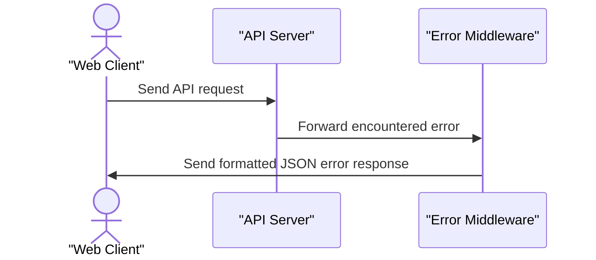

# E-Commerce Book Store API

E-Commerce Book Store API provides a clean foundation for powering digital bookstore storefronts. It manages incoming client requests and standardizes responses so frontends can easily interact with store data. It keeps application logic tidy while ensuring every error returns predictable JSON data to the client.

## System Architecture


## Features

### Centralized Error Management
Incoming exceptions are caught by a unified middleware layer that logs the problem and sends a standardized JSON payload back to the client. This guarantees that unhandled failures still produce predictable responses instead of crashing the client interface.



### Automatic Request Body Parsing
Every incoming request with a JSON payload is parsed directly into memory. This allows downstream route handlers to immediately access request data without custom parsing utilities.

### Configurable Server Port Binding
The application reads port configuration dynamically from system variables, with a dependable fallback when no environment configuration is present.

## Technologies Used

| Technology | Purpose | Documentation |
| :--- | :--- | :--- |
| Node.js | JavaScript runtime environment | [nodejs.org](https://nodejs.org/) |
| Express 5 | Web framework and routing engine | [expressjs.com](https://expressjs.com/) |
| Dotenv | Environment variable management | [github.com/motdotla/dotenv](https://github.com/motdotla/dotenv) |

## Environment Variables

The server uses the following environment variable to configure network binding:

| Variable | Description | Default Value | Example |
| :--- | :--- | :--- | :--- |
| `PORT` | The port number on which the server listens | `5000` | `3000` |

### Setting Environment Variables at the System Level

If you wish to configure your environment variables at the operating system level, use the commands below.

Windows (PowerShell):
```powershell
setx PORT "3000"
```

macOS / Linux (including Termux on Android):
```bash
echo 'export PORT="3000"' >> ~/.bashrc
source ~/.bashrc
```

## Installation

Clone the repository to your local machine:
```bash
git clone https://github.com/Aisdev979/e-commerce_store_api.git
```

Navigate into the project directory:
```bash
cd e-commerce_store_api
```

Install the dependencies:
```bash
npm install
```

Create a local environment file:
```bash
touch .env
```

Add your preferred configuration to `.env`:
```text
PORT=3000
```

## Usage

Start the server using Node:
```bash
node server.js
```

Once running, verify that the service is operational:
```bash
curl http://localhost:3000/
```

Expected terminal output:
```text
Welcome to the E-commerce Book Store API!
```

## API Documentation

#### GET /

**Description**: Root health check endpoint that confirms the bookstore service is online and ready for traffic.

**Request**:
```text
GET / HTTP/1.1
Host: localhost:3000
```

**Response**:
```text
Welcome to the E-commerce Book Store API!
```

**Errors**:
- 500: Internal Server Error

Standard error response format:
```json
{
  "status": "error",
  "message": "Internal Server Error"
}
```

## Contributing

Contributions make open-source projects a great place to build software. To propose changes:

1. Fork the project repository.
2. Create your feature branch (`git checkout -b feature/new-feature`).
3. Commit your changes (`git commit -m "Add new feature"`).
4. Push the branch to your fork (`git push origin feature/new-feature`).
5. Open a Pull Request detailing the changes you made.

## Author

Ogbebor Aisosa Matthew

- LinkedIn: https://linkedin.com/in/aisosa-ogbebor-550073271
- X: https://x.com/OgbeborAisosa3

[](https://nodejs.org/)
[](https://expressjs.com/)

[](https://dokugen.samueltuoyo.com)