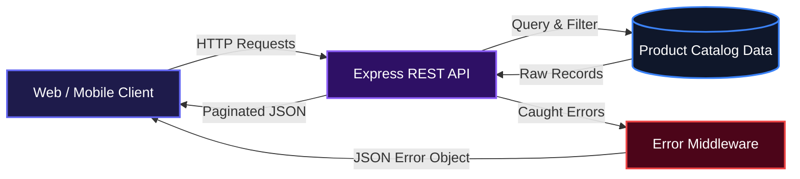
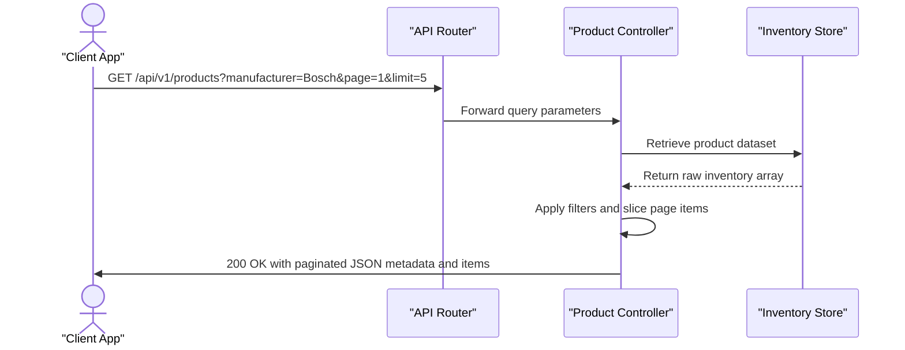
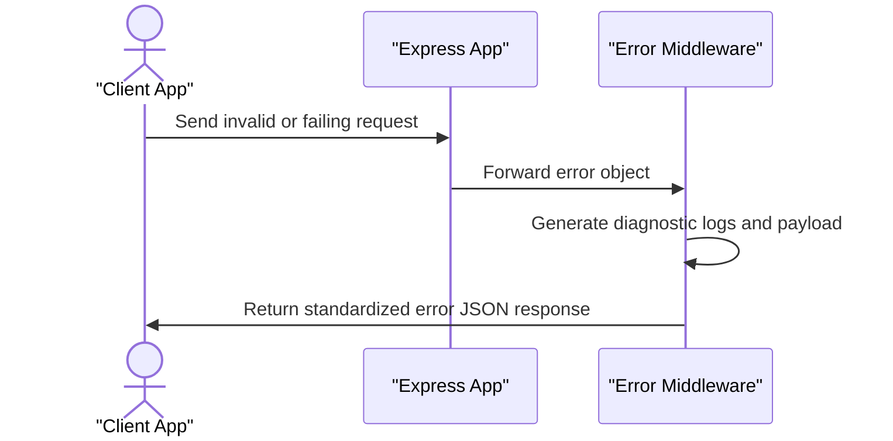

# E-Commerce Car Part Store API

E-Commerce Car Part Store API provides a clean backend for cataloging, filtering, and serving automotive parts inventory to modern client applications. It processes client queries to deliver structured, paginated replacement component records without complicated setup. It also intercepts server exceptions across routes and returns predictable error data to client frontends.

## System Architecture



## Features

### Parametric Catalog Filtering and Pagination
Storefronts can request specific subsets of parts using manufacturer and size parameters. The controller dynamically applies filters to the catalog and slices records according to custom page and limit queries, returning pagination metadata alongside the results.



### Centralized Error Handling
Unexpected runtime failures pass directly to a dedicated error-handling middleware. The handler formats the problem into a uniform JSON response and outputs debug diagnostics to the server console, including route paths, request methods, and call stacks.



### Standardized JSON Payloads
All responses follow consistent response envelopes, ensuring consuming applications can dependably parse pagination metadata, record counts, and data collections across endpoints.

## Technologies Used

| Technology | Purpose | Documentation |
| :--- | :--- | :--- |
| Node.js | JavaScript runtime environment | [nodejs.org](https://nodejs.org/) |
| Express 5 | Web routing framework | [expressjs.com](https://expressjs.com/) |
| Dotenv | Environment configuration manager | [github.com/motdotla/dotenv](https://github.com/motdotla/dotenv) |

## Environment Variables

The server uses environment variables to configure its runtime behavior:

| Variable | Description | Default Value | Example |
| :--- | :--- | :--- | :--- |
| `PORT` | Network port for listening on incoming requests | `5000` | `3000` |
| `NODE_ENV` | Runtime environment mode (`development` or `production`) | None | `development` |

### Setting Environment Variables at the System Level

To configure your environment variables at the operating system level, run the following commands:

Windows (PowerShell):
```powershell
setx PORT "3000"
```

macOS / Linux (including Termux on Android):
```bash
echo 'export PORT="3000"' >> ~/.bashrc
source ~/.bashrc
```

## Installation

Follow these steps to set up the project locally:

1. Clone the repository:
```bash
git clone https://github.com/Aisdev979/e-commerce_store_api.git
```

2. Navigate into the project directory:
```bash
cd e-commerce_store_api
```

3. Install project dependencies:
```bash
npm install
```

4. Create an environment file:
```bash
touch .env
```

5. Define your environment configuration inside `.env`:
```text
PORT=3000
NODE_ENV=development
```

## Usage

Start the application using Node:
```bash
node server.js
```

Verify that the service is running:
```bash
curl http://localhost:3000/
```

Expected terminal output:
```text
Welcome to the E-commerce Car Part Store API!
```

Query the automotive inventory with filters:
```bash
curl "http://localhost:3000/api/v1/products?manufacturer=Bosch&page=1&limit=5"
```

## API Documentation

### GET /

**Description**: Root health check endpoint that confirms the car parts store service is reachable.

**Request**:
```text
GET / HTTP/1.1
Host: localhost:3000
```

**Response**:
```text
Welcome to the E-commerce Car Part Store API!
```

**Errors**:
- 500: Internal Server Error

```json
{
  "status": "error",
  "message": "Internal Server Error",
  "statusCode": 500
}
```

---

### GET /api/v1/products

**Description**: Retrieves a paginated list of car parts, optionally filtered by manufacturer and part size.

**Query Parameters**:
- `manufacturer` (optional): Filter items by brand (e.g. `Bosch`, `Michelin`, `Brembo`).
- `size` (optional): Filter items by dimension or specification string (e.g. `205/55 R16`, `4 Litres`).
- `page` (optional, default: `1`): Current page index to fetch.
- `limit` (optional, default: `5`): Maximum number of items per page.

**Request**:
```text
GET /api/v1/products?manufacturer=Bosch&page=1&limit=5 HTTP/1.1
Host: localhost:3000
```

**Response**:
```json
{
  "success": true,
  "meta": {
    "totalRecord": 0,
    "curentPage": 1,
    "totalPags": 0
  },
  "data": [
    {
      "id": 1,
      "name": "Car Battery",
      "manufacturer": "Bosch",
      "size": "12V, 60Ah",
      "price": 85000,
      "category": "Electrical",
      "stock": 15
    },
    {
      "id": 9,
      "name": "Wiper Blades",
      "manufacturer": "Bosch",
      "size": "22 inches",
      "price": 12000,
      "category": "Accessories",
      "stock": 18
    }
  ]
}
```

**Errors**:
- 500: Internal Server Error

Standard error payload returned:
```json
{
  "status": "error",
  "message": "Internal Server Error",
  "statusCode": 500
}
```

When running in `development` mode, additional diagnostic information is included:
```json
{
  "status": "error",
  "message": "Internal Server Error",
  "statusCode": 500,
  "details": {
    "method": "GET",
    "url": "/api/v1/products",
    "route": "/products",
    "params": {},
    "query": {},
    "timestamp": "2025-01-01T00:00:00.000Z",
    "stack": "Error: Sample failure..."
  }
}
```

## Contributing

1. Fork the project repository.
2. Create your feature branch (`git checkout -b feature/new-part-filters`).
3. Commit your changes (`git commit -m "Add new part filters"`).
4. Push to the branch (`git push origin feature/new-part-filters`).
5. Open a Pull Request detailing the changes made.

## Author

Ogbebor Aisosa Matthew

- LinkedIn: https://linkedin.com/in/aisosa-ogbebor-550073271
- X: https://x.com/OgbeborAisosa3

[](https://nodejs.org/)
[](https://expressjs.com/)

[](https://dokugen.samueltuoyo.com)